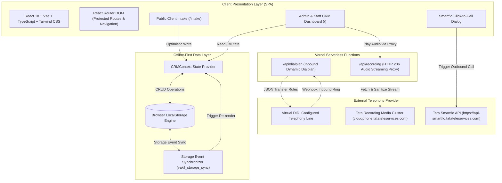
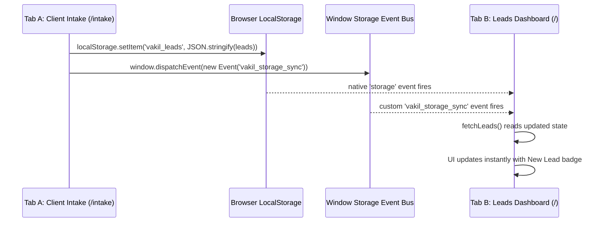
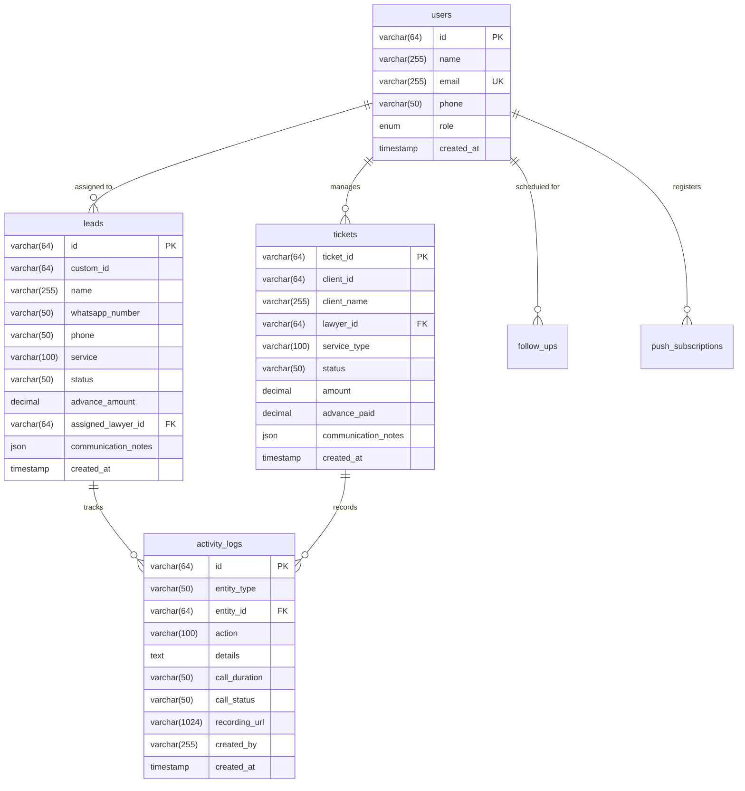
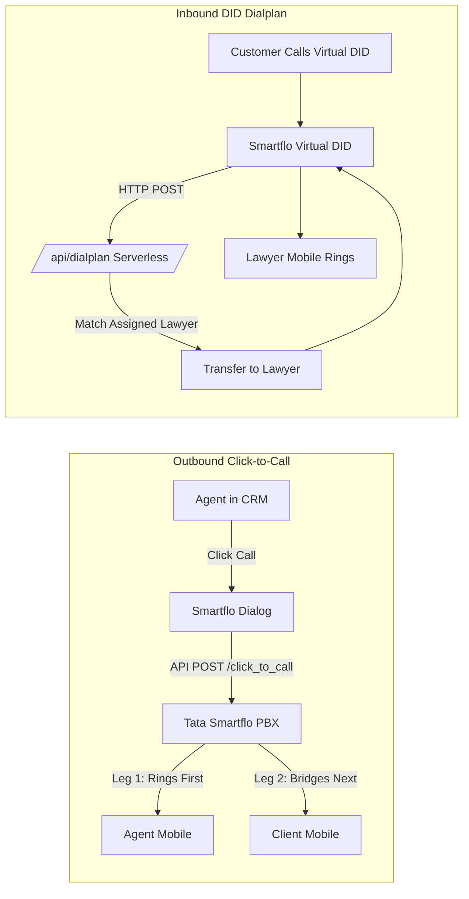
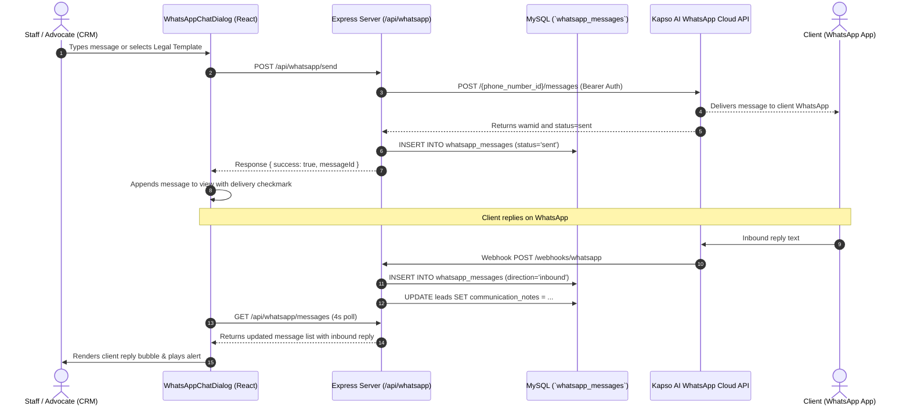

# System Architecture & Technical Design

This document details the architectural design, component structure, state management patterns, storage engine, and telephony subsystems of the **Vakil Lead Flow CRM & Cloud Telephony Platform**.

---



---

## 1. High-Level System Overview
The platform is built as a high-performance, offline-capable Single Page Application (SPA) paired with lightweight serverless functions for telephony coordination:
* **Frontend Core**: Built with React 18, Vite 7, TypeScript, Tailwind CSS, and Radix UI / shadcn component primitives.
* **Storage Engine**: Offline-first, browser-local persistence using structured `localStorage` with reactive cross-tab synchronization.
* **Serverless Functions**: Hosted on Vercel Node runtime at `/api/dialplan` and `/api/recording` to satisfy external telephony webhooks without requiring long-running server infrastructure.
* **Cloud Telephony**: Deep integration with Tata Tele Business Services (Smartflo) for bidirectional calls, number masking, and call recording management.

---

## 2. Storage Engine & State Architecture

### 2.1 Local Storage Schema
The CRM eliminates external database latency by persisting data in browser `localStorage`. Each record collection has a strictly typed schema:

| Storage Key | Type | Description |
| :--- | :--- | :--- |
| `vakil_leads` | `Lead[]` | Complete array of client inquiries, statuses, contact numbers, and communication logs. |
| `vakil_tickets` | `Ticket[]` | Active legal matters, billing totals, advance payments, and assigned case lawyers. |
| `vakil_users` | `CRMUser[]` | Registered system staff, roles (`super_admin`, `front_desk`, `lawyer`), and contact phones. |
| `vakil_auth_user` | `CRMUser` | Currently authenticated user session, role tokens, and profile identifiers. |
| `smartflo_user_phone_{id}` | `string` | User-specific 10-digit mobile number override for Smartflo two-way bridging. |
| `smartflo_agent_phone` | `string` | Global fallback calling mobile number (defaults to `9800000001` or env). |
| `vakil_push_sub_{id}` | `object` | Local Web Push subscription metadata for in-browser desktop notifications. |

### 2.2 Cross-Tab Reactive Synchronization
Because the CRM operates an intake portal at `/intake` and an internal dashboard at `/`, data entered on the public form or by staff in another tab must immediately synchronize without requiring manual page reloads.

This is accomplished via a dual-listener reactive synchronization engine in [CRMContext.tsx](file:///C:/Users/Ramanuj%20Dey%20Sarkar/Downloads/vakil-lead-flow-main/vakil-lead-flow-main/src/contexts/CRMContext.tsx):



```typescript
// Implementation in CRMContext.tsx
useEffect(() => {
  fetchLeads();
  fetchTickets();
  fetchLawyers();

  const handleStorageSync = () => {
    fetchLeads();
    fetchTickets();
    fetchLawyers();
  };

  window.addEventListener('storage', handleStorageSync);
  window.addEventListener('vakil_storage_sync', handleStorageSync);
  return () => {
    window.removeEventListener('storage', handleStorageSync);
    window.removeEventListener('vakil_storage_sync', handleStorageSync);
  };
}, []);
```

---

## 3. MySQL Relational Database Architecture

The platform includes a dedicated **MySQL / MariaDB** database tier paired with the backend server (`backend/smartflo/server.js`) to provide persistent relational storage, ACID compliance, and multi-user synchronization.

### 3.1 Entity-Relationship (ER) Architecture
The MySQL schema ([database/schema.sql](file:///C:/Users/Ramanuj%20Dey%20Sarkar/Downloads/vakil-lead-flow-main/vakil-lead-flow-main/database/schema.sql)) consists of 6 core tables:



### 3.2 Dual-Tier Hybrid State Synchronization
To maintain lightning-fast offline UI operations without sacrificing centralized database persistence:
1. **Frontend Optimistic Local Writes**: Actions on the frontend immediately update local React state and `localStorage`.
2. **Asynchronous MySQL REST Synchronization**: The frontend background-syncs mutations to `http://localhost:3001/api/leads` and `/api/tickets`.
3. **Graceful Offline Tolerance**: If the MySQL server is unreachable, the application continues to run in offline local-storage mode without crashing.
4. **Backend Telephony Integration**: Tata Smartflo webhooks (`/webhooks/smartflo/hangup` and `/webhooks/smartflo/missed`) write call durations, recording URLs, and missed alerts directly into MySQL.

---

## 4. Role-Based Access Control (RBAC) Matrix

The application provides strict boundary separation between administrative staff, intake operators, and case lawyers:

| Feature / Action | Super Admin | Front Desk | Lawyer (Case Handler) |
| :--- | :---: | :---: | :---: |
| **View Unassigned Leads** | ✅ Full Access | ✅ Full Access | ❌ Restricted |
| **Create New Lead / Public Intake** | ✅ Yes | ✅ Yes | ✅ Yes |
| **Assign Lawyer to Lead / Ticket** | ✅ Yes | ✅ Yes | ❌ Restricted |
| **View Full Client Mobile Number** | ✅ Full (Unmasked) | ⚠️ Masked (`+91 98••• ••210`) | ⚠️ Masked (`+91 98••• ••210`) |
| **Click-to-Call Customer (Smartflo)** | ✅ Yes | ✅ Yes | ✅ Yes (Assigned cases) |
| **Access Financials / Billing Analytics**| ✅ Full Access | ❌ Restricted | ⚠️ View Own Case Balances |
| **Manage Firm Team & Roles** | ✅ Full Access | ❌ Restricted | ❌ Restricted |
| **Access System Audit Logs** | ✅ Full Access | ❌ Restricted | ❌ Restricted |
| **Update Own Calling Number** | ✅ Yes | ✅ Yes | ✅ Yes |

---

## 4. Telephony Integration Architecture

The cloud telephony architecture handles both outbound click-to-call dialing and inbound call routing with dynamic lawyer resolution:



### 4.1 Number Masking Implementation
To protect customer privacy and prevent lawyer/agent bypass, all client telephone numbers are passed through `maskPhoneNumber()` in [src/lib/smartflo.ts](file:///C:/Users/Ramanuj%20Dey%20Sarkar/Downloads/vakil-lead-flow-main/vakil-lead-flow-main/src/lib/smartflo.ts):
```typescript
export function maskPhoneNumber(phone?: string | null, isSuperAdmin: boolean = false): string {
  if (!phone) return '••••••••••';
  if (isSuperAdmin) return phone.startsWith('+') ? phone : `+${phone}`;

  const cleaned = phone.replace(/^\+/, '').replace(/\s+/g, '');
  if (cleaned.length < 8) return '••••••••••';

  const prefix = cleaned.slice(0, 4); // Country code + first 2 digits
  const suffix = cleaned.slice(-3);  // Last 3 digits
  return `+${prefix.slice(0, 2)} ${prefix.slice(2)}••• ••${suffix}`;
}
```

### 4.2 Seekable Recording Streaming Proxy (`/api/recording`)
Tata Smartflo stores call recordings on an upstream cluster (`cloudphone.tatateleservices.com`). Standard HTML5 `<audio>` tags fail when accessing these URLs directly due to two issues:
1. **Malformed Headers**: Raw files return `Content-Type: audio/mpeg, audio/mp3`. Browsers require a single MIME type.
2. **Missing Range Support**: Scrubbing requires HTTP `Range: bytes=X-Y` headers.

The `/api/recording` endpoint proxies the audio file and intercepts headers:
* Sets `Content-Type: audio/mpeg`.
* Sets `Accept-Ranges: bytes`.
* Converts streaming chunks into HTTP `206 Partial Content` with `Content-Range: bytes START-END/TOTAL`.

---

## 5. In-CRM WhatsApp Messaging Subsystem (Kapso AI)

### 5.1 Architectural Workflow
The WhatsApp messaging subsystem allows advocates and front desk staff to converse with clients directly inside the CRM.
- **Outbound**: UI sends message via `POST /api/whatsapp/send` -> Express server calls Kapso WhatsApp Cloud API (`https://api.kapso.ai/meta/whatsapp/v24.0/{phone_number_id}/messages`) -> message delivered to customer WhatsApp.
- **Inbound**: Customer replies -> Kapso webhook dispatches to `POST /webhooks/whatsapp` -> server parses payload, looks up matching lead/ticket, and inserts record into MySQL `whatsapp_messages` table.
- **Client Reactive Polling**: The in-CRM `WhatsAppChatDialog` polls `GET /api/whatsapp/messages` every 4 seconds while active to render inbound replies dynamically without manual page refresh.
- **Fallback Simulation Engine**: If `KAPSO_API_KEY` is not populated or contains placeholder tokens, `backend/kapso/whatsapp.js` activates sandbox simulation mode, recording simulated message IDs and acknowledging requests locally.



---

## 6. Directory Structure & Key Files

```
vakil-lead-flow-main/
├── .env.example                         # Environment Variables Template
├── api/                                 # Vercel Serverless Functions
│   ├── dialplan.js                      # Smartflo Dynamic Dialplan Webhook
│   └── recording.js                     # HTTP 206 Seekable Call Recording Proxy
├── backend/                             # Backend Servers & External Integrations
│   ├── kapso/
│   │   └── whatsapp.js                  # Kapso AI WhatsApp Cloud API Integration Module
│   ├── scripts/
│   │   └── init-db.js                   # MySQL Schema Migration & Database Seeding Script
│   └── smartflo/
│       ├── server.js                    # Express MySQL REST & Telephony Server
│       └── smartflo-dialplan-webhook.js
├── database/
│   ├── schema.sql                       # Complete MySQL DDL Schema
│   └── seed.sql                         # Initial Seed Data for Users & Directory
├── docs/                                # Comprehensive Documentation Suite
│   ├── TIMELINE.md                      # Engineering & Evolution History
│   ├── CHANGELOG.md                     # SemVer Release Notes
│   ├── ARCHITECTURE.md                  # System Architecture (This file)
│   ├── KAPSO_WHATSAPP_INTEGRATION_GUIDE.md # Kapso AI WhatsApp Integration Manual
│   ├── TELEPHONY_INTEGRATION_GUIDE.md   # Tata Smartflo Technical Manual
│   ├── USER_AND_ADMIN_MANUAL.md         # Staff Operations & User Guide
│   ├── USER_ROLES_AND_WORKFLOWS.md      # Permissions & Userflow Diagrams
│   └── DEPLOYMENT_AND_RUNBOOK.md        # Build, Deploy & Recovery Runbook
├── src/
│   ├── components/                      # Reusable UI & Business Components
│   │   ├── SmartfloCallDialog.tsx       # Outbound Click-to-Call Modal
│   │   ├── WhatsAppChatDialog.tsx       # Interactive In-CRM WhatsApp Chat Modal
│   │   ├── QuickActions.tsx             # Universal Call, WhatsApp & Payment Toolbar
│   │   ├── SmartfloDialplanSettings.tsx # Webhook Inbound Tester
│   │   ├── StatusBadges.tsx             # Visual Pipeline Indicators
│   │   └── ui/                          # shadcn/ui Component Primitives
│   ├── contexts/
│   │   └── CRMContext.tsx               # Core MySQL & LocalStorage Reactivity Engine
│   ├── data/
│   │   └── mockData.ts                  # Production Role Definitions
│   ├── lib/
│   │   ├── kapso.ts                     # Frontend Kapso AI Client & Legal Templates
│   │   ├── smartflo.ts                  # Telephony Configuration & API Clients
│   │   └── pushNotifications.ts         # Browser Push Notification Manager
│   ├── pages/                           # Primary Routed Views
│   │   ├── LeadsDashboard.tsx           # Kanban & Lead Triage
│   │   ├── LeadDetail.tsx               # Lead Profiling & WhatsApp Chat Banner
│   │   ├── LeadIntake.tsx               # Public & Staff Client Intake Portal (/intake)
│   │   ├── Tickets.tsx                  # Case Matter & Billing Management
│   │   ├── TicketDetail.tsx             # Legal Case Files & WhatsApp Messenger
│   │   ├── FollowUps.tsx                # Scheduled Callback Reminders
│   │   ├── Login.tsx                    # Hardened Credential Authentication
│   │   └── MorePage.tsx                 # User Profile & Calling Number Controls
│   └── types/
│       └── crm.ts                       # TypeScript Domain Models
├── README.md                            # Master Project Overview
└── vercel.json                          # Vercel Deployment & Routing Configuration
```
