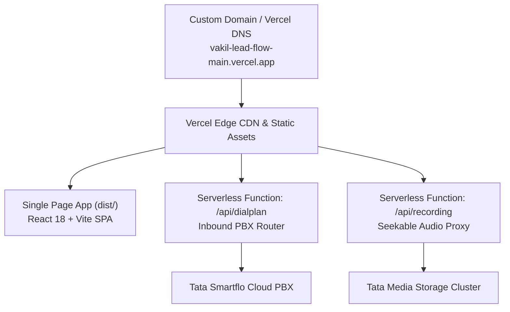

# Deployment, Operations & Disaster Recovery Runbook

This runbook provides complete engineering procedures for deploying, maintaining, monitoring, and backing up the **Vakil Lead Flow CRM & Cloud Telephony Platform**.

---

## 1. Hosting Architecture & Topology

The production application is deployed on **Vercel's Edge Network** with serverless compute:



### 1.1 Vercel Routing Configuration (`vercel.json`)
The [vercel.json](file:///C:/Users/Ramanuj%20Dey%20Sarkar/Downloads/vakil-lead-flow-main/vakil-lead-flow-main/vercel.json) file manages SPA client routing and serverless function exposure:
```json
{
  "rewrites": [
    { "source": "/api/dialplan", "destination": "/api/dialplan.js" },
    { "source": "/api/recording", "destination": "/api/recording.js" },
    { "source": "/(.*)", "destination": "/index.html" }
  ],
  "headers": [
    {
      "source": "/api/(.*)",
      "headers": [
        { "key": "Access-Control-Allow-Origin", "value": "*" },
        { "key": "Access-Control-Allow-Methods", "value": "GET,POST,OPTIONS" },
        { "key": "Access-Control-Allow-Headers", "value": "Content-Type,Authorization" }
      ]
    }
  ]
}
```

---

## 2. Local Development Environment

### 2.1 Prerequisites
* **Node.js**: v20.x or higher
* **Package Manager**: `npm` or `pnpm` (v9+)
* **Git**: Installed and configured

### 2.2 Step-by-Step Installation
1. Clone the repository and navigate into the root directory:
   ```bash
   git clone <REPOSITORY_URL>
   cd vakil-lead-flow-main
   ```
2. Install dependencies:
   ```bash
   npm install
   # or
   pnpm install
   ```
3. Launch the Vite local development server:
   ```bash
   npm run dev
   ```
4. Access the application in your browser at `http://localhost:8080`.

### 2.3 Verification & Build Gates
Before deploying changes to production, execute all validation gates:
```bash
# 1. Type Safety Check (Zero errors required)
npx tsc --noEmit

# 2. Production Vite Bundle Build
npm run build

# 3. Unit Test Execution
npm run test
```

---

## 3. Production Deployment

### 3.1 Deploying to Vercel
Deployments are managed via the Vercel CLI:

```bash
# Authenticate & Deploy directly to production
npx vercel --prod --yes
```

Upon completion, Vercel will output:
* Deployment ID: `dpl_xxxxxxxxxxxx`
* Production URL: `https://vakil-lead-flow-main.vercel.app`
* Verification status: `READY`

### 3.2 Deploying the Standalone Fallback Microservice (Render / Railway)
If an independent containerized dialplan fallback is required:
1. Navigate to `backend/smartflo/`.
2. Connect your repository to Render.com.
3. Render automatically reads [render.yaml](file:///C:/Users/Ramanuj%20Dey%20Sarkar/Downloads/vakil-lead-flow-main/vakil-lead-flow-main/render.yaml):
   ```yaml
   services:
     - type: web
       name: vakil-smartflo-dialplan
       env: node
       plan: free
       buildCommand: ""
       startCommand: "node backend/smartflo/server.js"
       envVars:
         - key: PORT
           value: 10000
         - key: FALLBACK_AGENT_PHONE
           value: 919800000000
   ```
4. Provide the generated Render URL (e.g. `https://vakil-smartflo-dialplan.onrender.com/dialplan`) as a secondary failover destination in the Tata Smartflo portal.

---

## 4. Data Management & Backup Procedures

Because the CRM operates an offline-first `localStorage` storage engine, data resides securely within client browsers. Administrators can back up, restore, or export datasets using the following browser console utilities:

### 4.1 Exporting a Complete CRM Backup (JSON Snapshot)
Open the browser developer console (F12) while on the CRM dashboard and execute:

```javascript
(function exportCrmData() {
  const backup = {
    exportDate: new Date().toISOString(),
    version: "2.2.0",
    leads: JSON.parse(localStorage.getItem('vakil_leads') || '[]'),
    tickets: JSON.parse(localStorage.getItem('vakil_tickets') || '[]'),
    users: JSON.parse(localStorage.getItem('vakil_users') || '[]'),
    agentPhone: localStorage.getItem('smartflo_agent_phone') || '9800000001'
  };

  const blob = new Blob([JSON.stringify(backup, null, 2)], { type: 'application/json' });
  const a = document.createElement('a');
  a.href = URL.createObjectURL(blob);
  a.download = `vakil_crm_backup_${new Date().toISOString().slice(0, 10)}.json`;
  a.click();
  console.log('✓ Backup generated successfully:', backup);
})();
```

### 4.2 Restoring from a JSON Backup Snapshot
To restore data into a clean browser session:

```javascript
function restoreCrmData(backupJsonString) {
  const data = JSON.parse(backupJsonString);
  if (data.leads) localStorage.setItem('vakil_leads', JSON.stringify(data.leads));
  if (data.tickets) localStorage.setItem('vakil_tickets', JSON.stringify(data.tickets));
  if (data.users) localStorage.setItem('vakil_users', JSON.stringify(data.users));
  window.dispatchEvent(new Event('vakil_storage_sync'));
  console.log('✓ CRM data restored. Reloading page...');
  window.location.reload();
}
```

### 4.3 Purging Test Data (Factory Reset)
To reset the CRM to a pristine production state with zero dummy data:
```javascript
localStorage.removeItem('vakil_leads');
localStorage.removeItem('vakil_tickets');
localStorage.removeItem('vakil_auth_user');
window.location.href = '/login';
```

---

## 5. Health Monitoring & Webhook Diagnostics

### 5.1 Dialplan Health Probe
Verify that the inbound dialplan serverless function is reachable and responding with valid Tata Smartflo JSON:

```bash
curl -X POST https://your-domain.com/api/dialplan \
  -H "Content-Type: application/json" \
  -d '{"caller_id_number": "9876543210", "call_to_number": "917900000000"}'
```

**Expected Response**:
```json
[
  {
    "disable_call_recording": false,
    "transfer": {
      "type": "number",
      "data": ["9800000000"],
      "ring_type": "order_by",
      "skip_active": true
    }
  }
]
```

### 5.2 Recording Proxy Probe
Test that the audio streaming proxy successfully sanitizes audio headers:

```bash
curl -I "https://vakil-lead-flow-main.vercel.app/api/recording?url=https%3A%2F%2Fwww.soundhelix.com%2Fexamples%2Fmp3%2FSoundHelix-Song-1.mp3"
```

**Expected Headers**:
```http
HTTP/1.1 200 OK
Content-Type: audio/mpeg
Accept-Ranges: bytes
Access-Control-Allow-Origin: *
```

---

## 6. Disaster Recovery Procedures

| Scenario | Severity | Immediate Remediation |
| :--- | :--- | :--- |
| **Vercel Deployment Failure / Build Error** | Critical | 1. Check Vercel build logs with `npx vercel inspect`.<br/>2. Verify local compilation with `npx tsc --noEmit && npm run build`.<br/>3. Re-run `npx vercel --prod --yes`. |
| **Inbound Calls Drop (Smartflo Failure)** | High | 1. Log in to TTBS Smartflo portal.<br/>2. Open Virtual DID settings.<br/>3. Check failover destination is set to fallback mobile number.<br/>4. Verify `/api/dialplan` URL is active. |
| **Browser Storage Corrupted** | Low | 1. Run the data restore script in section 4.2.<br/>2. If no backup exists, log out and log in again; default firm users and configurations will automatically re-initialize. |
