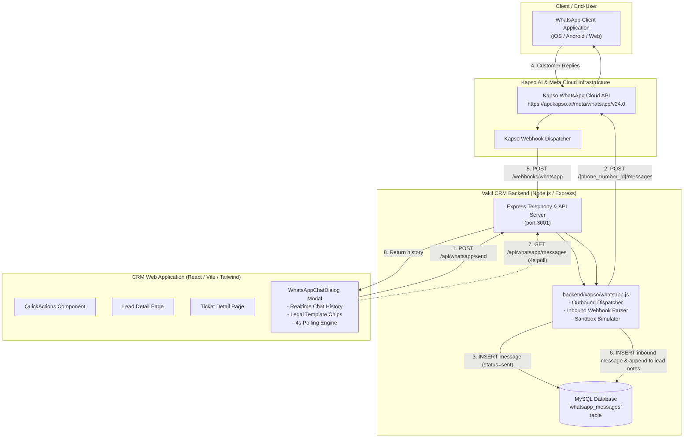

# Kapso AI In-CRM WhatsApp Integration Guide

## 1. Executive Summary

This document describes the native **In-CRM WhatsApp Chat Integration** built for the **Vakil Lead Flow CRM** platform using **Kapso AI** (`https://docs.kapso.ai/docs/introduction`).

Previously, interacting with leads or clients on WhatsApp required navigating away to external `wa.me` links or manual phone WhatsApp apps. With this integration:
- Advocates, front desk staff, and super administrators can interact with clients **directly within the CRM interface**.
- Full conversational message history is persistently stored in **MySQL** (`whatsapp_messages` table).
- Outbound messages are delivered instantly via Kapso's Meta WhatsApp Cloud API (`v24.0`).
- Incoming replies from clients are processed in real-time via Kapso webhooks and displayed live inside the CRM with automatic 4-second reactive polling.
- Pre-approved legal templates (Consultation Welcome, Document Checklist Request, Draft Notice Ready, Hearing Date Updates, Fee Settlement Receipts) can be inserted with one click.
- A built-in sandbox simulation mode allows full offline testing without burning production API credits.

---

## 2. End-to-End System Architecture



---

## 3. Database Schema

The integration introduces the `whatsapp_messages` table within MySQL ([database/schema.sql](file:///C:/Users/Ramanuj%20Dey%20Sarkar/Downloads/vakil-lead-flow-main/vakil-lead-flow-main/database/schema.sql)):

```sql
CREATE TABLE IF NOT EXISTS whatsapp_messages (
    id VARCHAR(64) PRIMARY KEY,
    lead_id VARCHAR(64) NULL,
    ticket_id VARCHAR(64) NULL,
    phone_number VARCHAR(20) NOT NULL,
    direction ENUM('inbound', 'outbound') NOT NULL,
    sender_id VARCHAR(64) NULL,
    sender_name VARCHAR(120) NULL,
    message_type VARCHAR(20) DEFAULT 'text',
    content TEXT NOT NULL,
    status ENUM('queued', 'sent', 'delivered', 'read', 'failed') DEFAULT 'sent',
    kapso_message_id VARCHAR(128) NULL,
    created_at TIMESTAMP DEFAULT CURRENT_TIMESTAMP,
    INDEX idx_wa_phone (phone_number),
    INDEX idx_wa_lead (lead_id),
    INDEX idx_wa_ticket (ticket_id),
    INDEX idx_wa_created (created_at)
) ENGINE=InnoDB DEFAULT CHARSET=utf8mb4 COLLATE=utf8mb4_unicode_ci;
```

### Key Field Descriptions:
- **`id`**: Unique identifier for CRM tracking (e.g. `wa_msg_1732289456123`).
- **`lead_id` / `ticket_id`**: Foreign association allowing messages to be queried for specific leads or open tickets.
- **`direction`**: `'outbound'` (advocate/staff to client) or `'inbound'` (client reply).
- **`status`**: `'queued'`, `'sent'`, `'delivered'`, `'read'`, or `'failed'`.
- **`kapso_message_id`**: WhatsApp message identifier returned by Kapso Cloud API for delivery receipts.

---

## 4. Kapso AI Backend Integration

The backend service module is implemented in [backend/kapso/whatsapp.js](file:///C:/Users/Ramanuj%20Dey%20Sarkar/Downloads/vakil-lead-flow-main/vakil-lead-flow-main/backend/kapso/whatsapp.js) and integrated into the primary Express server ([backend/smartflo/server.js](file:///C:/Users/Ramanuj%20Dey%20Sarkar/Downloads/vakil-lead-flow-main/vakil-lead-flow-main/backend/smartflo/server.js)).

### 4.1 Configuration Environment Variables

Add the following to your `.env` or system environment:

```env
# --- Kapso AI WhatsApp Cloud API Configuration ---
KAPSO_API_KEY=your_actual_kapso_api_key_here
KAPSO_PHONE_NUMBER_ID=your_registered_phone_number_id_here
KAPSO_BASE_URL=https://api.kapso.ai/meta/whatsapp/v24.0
KAPSO_WEBHOOK_VERIFY_TOKEN=your_custom_webhook_secret_token
```

### 4.2 Outbound Message Dispatch

Endpoint: `POST https://api.kapso.ai/meta/whatsapp/v24.0/{phone_number_id}/messages`

Headers:
```http
Authorization: Bearer <KAPSO_API_KEY>
Content-Type: application/json
```

Text Payload format:
```json
{
  "messaging_product": "whatsapp",
  "recipient_type": "individual",
  "to": "919876543210",
  "type": "text",
  "text": {
    "preview_url": false,
    "body": "Hi Rajesh, this is Adv. Sneha from Vakiltech regarding your trademark matter."
  }
}
```

Template Payload format (Meta pre-approved utility/marketing template):
```json
{
  "messaging_product": "whatsapp",
  "to": "919876543210",
  "type": "template",
  "template": {
    "name": "hearing_date_notification",
    "language": { "code": "en" },
    "components": []
  }
}
```

### 4.3 Simulation / Sandbox Fallback

When `KAPSO_API_KEY` is missing or contains the default placeholder (`your_kapso_api_key_here`), `backend/kapso/whatsapp.js` automatically switches to **Sandbox Simulation Mode**:
- Outbound messages are generated with a simulated ID (`sim_msg_<timestamp>`) and saved to MySQL.
- A simulated confirmation reply is queued, allowing developers and reviewers to test two-way communication without incurring WhatsApp Business fees or requiring live Meta business verification.

---

## 5. Backend Server REST Endpoints

### 5.1 Fetch Message History
`GET /api/whatsapp/messages`

**Query Parameters**:
- `leadId` (optional): Filter messages by lead ID.
- `ticketId` (optional): Filter messages by ticket ID.
- `phone` (optional): Filter by client phone number (normalized).

**Response**:
```json
{
  "success": true,
  "count": 12,
  "messages": [
    {
      "id": "wa_msg_1732289456123",
      "lead_id": "LD1001",
      "ticket_id": null,
      "phone_number": "919876543210",
      "direction": "outbound",
      "sender_id": "u2",
      "sender_name": "Adv. Sneha",
      "message_type": "text",
      "content": "Hi Rajesh, please upload your Aadhaar card for drafting.",
      "status": "delivered",
      "created_at": "2026-11-22T10:15:00.000Z"
    }
  ]
}
```

### 5.2 Send Outbound Message
`POST /api/whatsapp/send`

**Request Body**:
```json
{
  "leadId": "LD1001",
  "ticketId": "TKT1001",
  "to": "9876543210",
  "text": "Your notice draft is ready for review.",
  "templateName": null,
  "senderId": "u2",
  "senderName": "Adv. Sneha"
}
```

**Response**:
```json
{
  "success": true,
  "messageId": "wa_msg_1732289567890",
  "kapsoMessageId": "wamid.HBgMOTE...",
  "status": "sent",
  "simulated": false
}
```

### 5.3 Webhook Verification & Receiving

1. **Verification Challenge (Meta/Kapso)**:
   `GET /webhooks/whatsapp`
   Validates `hub.mode === 'subscribe'` and `hub.verify_token === KAPSO_WEBHOOK_VERIFY_TOKEN`, returning `hub.challenge`.

2. **Inbound Message Event**:
   `POST /webhooks/whatsapp` (and `/webhooks/kapso/whatsapp`)
   Handles incoming payloads from Kapso AI:
   - Extracts sender phone number, contact profile name, and message text/media.
   - Matches phone number against active leads in MySQL.
   - Inserts row into `whatsapp_messages` with `direction = 'inbound'`.
   - Appends an entry into the lead's `communication_notes.activity_logs`.

---

## 6. Frontend CRM User Interface

### 6.1 `WhatsAppChatDialog` Component
Located at [src/components/WhatsAppChatDialog.tsx](file:///C:/Users/Ramanuj%20Dey%20Sarkar/Downloads/vakil-lead-flow-main/vakil-lead-flow-main/src/components/WhatsAppChatDialog.tsx):
- **Full Chat History**: Distinguishes inbound client bubbles (white/left) from outbound advocate bubbles (green/right) with timestamp and delivery ticks (`✓` = sent, `✓✓` = delivered/read).
- **Reactive Polling**: Automatically polls `GET /api/whatsapp/messages` every 4 seconds while open to receive incoming replies in real-time.
- **Auto-Scroll**: Scrolls smoothly to the latest message as new communication arrives.
- **Direct Link Fallback**: An external link button in the dialog header lets users open `wa.me` in WhatsApp Web at any time.

### 6.2 Pre-Approved Quick Legal Templates
Advocates and staff can insert pre-canned legal messages directly into the composer with one click:
1. **Consultation Welcome**: Greeting with legal team introduction.
2. **Document Checklist Request**: Request for KYC and evidence documents.
3. **Draft Ready for Review**: Notification that petition/notice draft is ready.
4. **Court Hearing Date Update**: Notification of upcoming hearing dates.
5. **Fee Settlement Receipt**: Confirmation of fee receipt and next milestones.

### 6.3 Universal Access Points
- **Lead Detail Page ([src/pages/LeadDetail.tsx](file:///C:/Users/Ramanuj%20Dey%20Sarkar/Downloads/vakil-lead-flow-main/vakil-lead-flow-main/src/pages/LeadDetail.tsx))**: Featured "WhatsApp Chat" banner and QuickActions button.
- **Ticket Detail Page ([src/pages/TicketDetail.tsx](file:///C:/Users/Ramanuj%20Dey%20Sarkar/Downloads/vakil-lead-flow-main/vakil-lead-flow-main/src/pages/TicketDetail.tsx))**: Dedicated case messenger banner for case lawyers.
- **Leads and Tickets Overview ([src/pages/Tickets.tsx](file:///C:/Users/Ramanuj%20Dey%20Sarkar/Downloads/vakil-lead-flow-main/vakil-lead-flow-main/src/pages/Tickets.tsx))**: QuickActions popup with "In-CRM Live Chat" trigger.

---

## 7. Security & Compliance

- **Zero Hardcoded Secrets**: All Kapso API keys, verify tokens, and database passwords are read strictly from process environment variables.
- **Phone Number Masking**: Standard advocates and staff view phone numbers masked as `+91 98*** **210`. Only Super Administrators can toggle unmasking via permission checks.
- **Audit Trail**: Every message sent or received logs an activity entry in MySQL.

---

## 8. Kapso Webhook Setup on Kapso Portal

To connect production webhooks:
1. Log in to [Kapso Portal](https://kapso.ai).
2. Go to **WhatsApp Cloud API -> Webhooks**.
3. Set **Callback URL** to: `https://your-crm-domain.com/webhooks/whatsapp`.
4. Set **Verify Token** to your configured `KAPSO_WEBHOOK_VERIFY_TOKEN`.
5. Subscribe to the following webhook fields:
   - `messages` (for incoming client replies)
   - `message_deliveries` (for delivery receipts)
   - `message_reads` (for read receipts)
6. Click **Save & Verify**.
