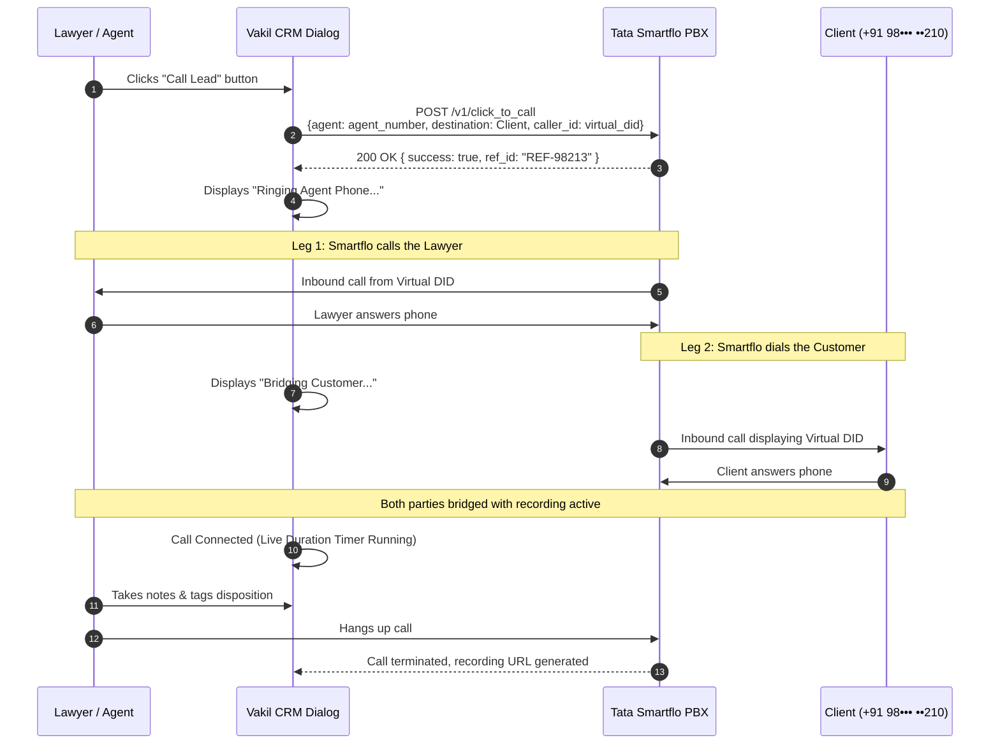
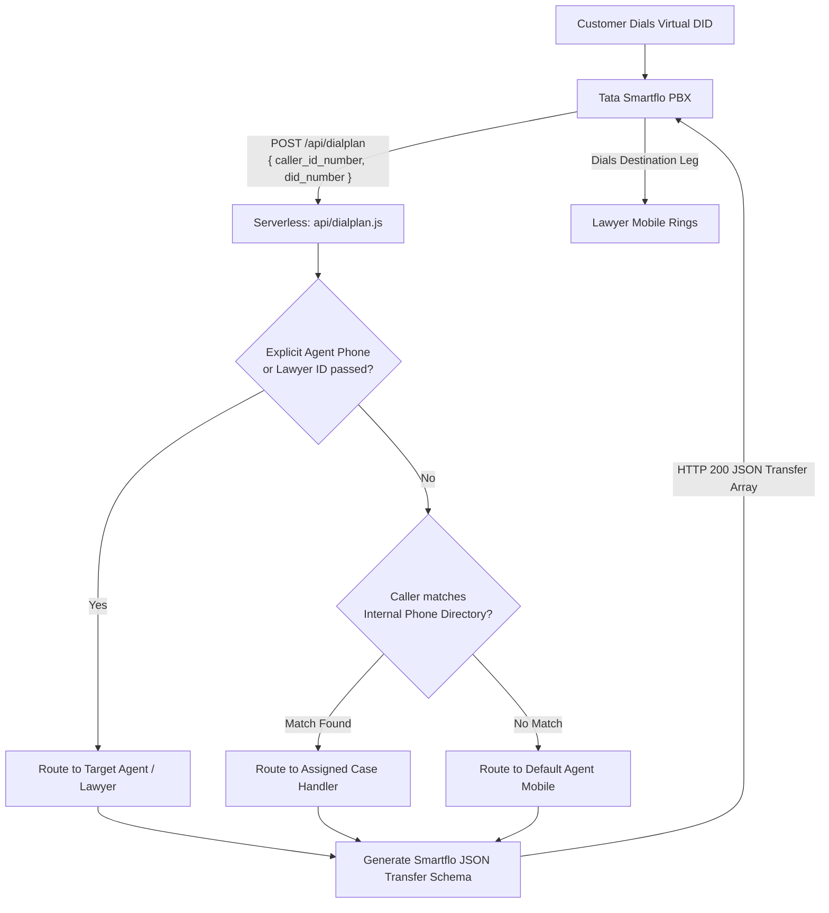

# Tata Smartflo Cloud Telephony Integration Guide

This guide is the complete technical and operational manual for the **Tata Tele Business Services (TTBS) Smartflo Cloud Telephony** integration in the Vakil Lead Flow platform.

---

## 1. System Specifications & Configuration

The platform connects to the Tata Smartflo cloud PBX infrastructure via RESTful APIs and real-time HTTP webhooks:

| Parameter | Configuration Value | Description |
| :--- | :--- | :--- |
| **Virtual Pilot DID** | `Configured in .env` | The company's virtual telephone number presented on customer caller IDs and used for inbound calls (e.g. `917900000000`). |
| **Primary Verified Agent Phone** | `Configured in .env` | Default agent/lawyer mobile number dialed first on two-way calls (e.g. `9800000001`). |
| **API Base URL** | `https://api-smartflo.tatateleservices.com` | Upstream TTBS cloud telephony API endpoint. |
| **Outbound Click-to-Call Path** | `/v1/click_to_call` | REST endpoint used to trigger automated two-way voice bridging. |
| **Inbound Webhook Endpoint** | `https://vakil-lead-flow-main.vercel.app/api/dialplan` | Serverless HTTP webhook consulted dynamically by Smartflo on every incoming ring. |
| **Call Recording Proxy** | `https://vakil-lead-flow-main.vercel.app/api/recording` | Dedicated streaming proxy resolving MIME corruption and enabling audio scrubbing. |

---

## 2. Outbound Click-to-Call (Two-Way Bridging)

### 2.1 Bridging Sequence
To preserve lawyer privacy and record all client interactions, the system never dials the customer directly from a lawyer's phone. Instead, Smartflo acts as an automated two-leg bridge:



### 2.2 Click-to-Call API Request Format
The CRM executes the outbound bridge via [src/lib/smartflo.ts](file:///C:/Users/Ramanuj%20Dey%20Sarkar/Downloads/vakil-lead-flow-main/vakil-lead-flow-main/src/lib/smartflo.ts) using the following payload:

```http
POST https://api-smartflo.tatateleservices.com/v1/click_to_call HTTP/1.1
Authorization: Bearer <SMARTFLO_API_JWT_TOKEN>
Content-Type: application/json

{
  "agent_number": "919800000001",
  "destination_number": "919876543210",
  "caller_id": "917900000000",
  "async": 1
}
```

* **`agent_number`**: Retrieved dynamically from the active user's profile (`currentUser.phone`).
* **`destination_number`**: The clean 10- or 12-digit mobile number of the client.
* **`caller_id`**: The company Virtual Pilot DID configured in environment variables.
* **`async: 1`**: Instructs Smartflo to process the call asynchronously and return a tracking `ref_id`.

---

## 3. Inbound Telephony: Method 2 Dynamic API Dialplan

When a client dials the company virtual number, Smartflo queries our dynamic dialplan webhook at `/api/dialplan` to determine where to route the call.



### 3.1 Webhook Request Schema (From Smartflo)
Smartflo triggers an HTTP `POST` (or `GET`) request with the caller details:

```json
{
  "caller_id_number": "9988776655",
  "call_to_number": "917900000000",
  "call_id": "CALL-10928374",
  "timestamp": "2026-11-21 14:30:15"
}
```

### 3.2 Webhook Response Schema (Returned to Smartflo)
The webhook responds with a valid Tata Smartflo Transfer Array:

```json
[
  {
    "disable_call_recording": false,
    "transfer": {
      "type": "number",
      "data": [
        "9800000001"
      ],
      "ring_type": "order_by",
      "skip_active": true
    }
  }
]
```

* **`disable_call_recording: false`**: Ensures all incoming calls are recorded for quality and compliance.
* **`type: "number"`**: Instructs the PBX to forward to an external PSTN mobile number.
* **`data: ["9800000001"]`**: Array of 10-digit Indian numbers to ring.
* **`ring_type: "order_by"`**: Rings numbers in sequential priority order.
* **`skip_active: true`**: Skips numbers that are currently engaged in another call.

---

## 4. Seekable Call Recording Streaming Proxy (`/api/recording`)

### 4.1 Upstream Issue
Raw recordings stored on Tata's media cluster (`https://cloudphone.tatateleservices.com/file/recording/...`) fail to play in modern browsers due to two critical issues:
1. **Invalid MIME Types**: Upstream headers return `Content-Type: audio/mpeg, audio/mp3`. Browsers reject multiple comma-separated MIME types for media tags.
2. **Missing Range Requests**: Browsers require HTTP `Range: bytes=0-` headers to determine file duration and allow users to seek back and forth. Upstream Tata servers drop range headers, locking the audio timeline at `00:00`.

### 4.2 Proxy Implementation (`api/recording.js`)
The CRM passes all recording URLs through our dedicated audio proxy:
```
/api/recording?url=https%3A%2F%2Fcloudphone.tatateleservices.com%2Ffile%2Frecording%2F...
```

The proxy performs the following operations:
1. Validates and sanitizes the remote URL.
2. Intercepts the HTTP request, forwarding the client's `Range` header to upstream servers.
3. Sanitizes the response headers:
   * Strips duplicate MIME types and sets `Content-Type: audio/mpeg`.
   * Sets `Accept-Ranges: bytes`.
   * Responds with status **HTTP 206 Partial Content** and an accurate `Content-Range: bytes START-END/TOTAL`.
4. Streams the raw binary MP3 audio buffer cleanly into the browser `<audio>` element.

---

## 5. Privacy Number Masking Matrix

To prevent lead leakage and protect client privacy, phone numbers are masked across the interface based on user role:

| Role | Displayed Format | Example |
| :--- | :--- | :--- |
| **Super Admin** | Full Unmasked Number | `+91 9876543210` |
| **Front Desk** | Masked (Country code + first 2 + last 3) | `+91 98••• ••210` |
| **Case Lawyer** | Masked (Country code + first 2 + last 3) | `+91 98••• ••210` |
| **Public Lead Intake** | Plain text during entry; masked after submission | `+91 98••• ••210` |

---

## 6. Telephony Troubleshooting & Diagnostics

| Symptom | Probable Cause | Diagnostic & Resolution |
| :--- | :--- | :--- |
| **Customer calls DID but hears busy tone** | Webhook timeout or misconfigured Smartflo dialplan. | 1. Open [SmartfloDialplanSettings.tsx](file:///C:/Users/Ramanuj%20Dey%20Sarkar/Downloads/vakil-lead-flow-main/vakil-lead-flow-main/src/components/SmartfloDialplanSettings.tsx) in More tab.<br/>2. Click "Test Dialplan Webhook".<br/>3. Verify HTTP 200 with transfer data `['9800000001']`. |
| **Agent phone does not ring when clicking "Call Lead"** | Calling number in profile is wrong or agent is offline. | 1. Navigate to **More** page in the CRM.<br/>2. Check **Smartflo Calling Mobile**.<br/>3. Click "Change" and verify your 10-digit number. |
| **Call connects but customer sees a private mobile number** | Pilot number misconfigured in outbound payload. | Verify `caller_id` in `SMARTFLO_CONFIG` is configured in `.env` / [src/lib/smartflo.ts](file:///C:/Users/Ramanuj%20Dey%20Sarkar/Downloads/vakil-lead-flow-main/vakil-lead-flow-main/src/lib/smartflo.ts). |
| **Recording says "Error loading audio"** | Raw Tata recording link used without `/api/recording` proxy. | Ensure all audio links are wrapped with `formatPlayableAudioUrl(url)`. |
