```mermaid
flowchart TD
    P1["Phase 1: Foundation & Scaffolding<br/>• React, Vite, TS, Tailwind<br/>• RBAC Roles & UI Modules"] --> P2["Phase 2: Tata Smartflo Integration<br/>• Outbound Click-to-Call<br/>• Virtual DID Provisioning<br/>• Number Masking"]
    P2 --> P3["Phase 3: Inbound Telephony Diagnosis<br/>• DID Inbound Ring Diagnosis<br/>• Root Cause: Static Forwarding Limits"]
    P3 --> P4["Phase 4: Method 2 Dynamic API Dialplan<br/>• Dynamic /api/dialplan Webhook<br/>• Standalone Node Service<br/>• CRM Lead & Lawyer Matching"]
    P4 --> P5["Phase 5: Audio Recording Stream Fix<br/>• Empty Recording / Playback Error<br/>• /api/recording Proxy with HTTP 206<br/>• Audio Seeking & MIME Header Sanitization"]
    P5 --> P6["Phase 6: Production Readiness & Intake<br/>• Zero Dummy Data Cleanup<br/>• Public Lead Intake Portal (/intake)<br/>• Cross-Tab CRM Synchronization"]
    P6 --> P7["Phase 7: Profile Phone & Auth Hardening<br/>• Calling Number from Profile<br/>• Removal of Test Role Buttons<br/>• Dedicated Role Credentials"]
    P7 --> P8["Phase 8: Full AWS Decoupling<br/>• Pure localStorage Storage Engine<br/>• Zero Network Latency & Offline-First<br/>• Event-Driven Cross-Tab Reactivity"]
    P8 --> P9["Phase 9: Telephony Number Configuration & Sanitization<br/>• Environment Variable Centralization<br/>• Local & Standalone Telephony Execution"]
```

# Engineering & Architectural Evolution Timeline

This document provides a chronological, exhaustive history of the **Vakil Lead Flow CRM & Cloud Telephony Platform**. It outlines every phase of research, architectural shift, telephony diagnosis, bug resolution, and operational optimization.

---



---

## Phase 1: Foundation & RBAC Scaffolding
* **Focus**: UI Scaffolding, Role Models, and Core CRM Workflows.
* **Key Achievements**:
  * Scaffolding the React 18, Vite, TypeScript, Tailwind CSS, and shadcn/ui application.
  * Designing the Role-Based Access Control (RBAC) hierarchy:
    * **Super Admin**: High-level reporting, system analytics, audit logs, team allocation, and full access.
    * **Front Desk**: High-speed intake, new lead triage, initial follow-ups, and lawyer assignment.
    * **Lawyer (Case Handler)**: Filtered views strictly for active cases, case notes, drafted notices, and retainer billing.
  * Building primary modules:
    * [LeadsDashboard.tsx](file:///C:/Users/Ramanuj%20Dey%20Sarkar/Downloads/vakil-lead-flow-main/vakil-lead-flow-main/src/pages/LeadsDashboard.tsx) (Kanban stages, triage lists, filters).
    * [Tickets.tsx](file:///C:/Users/Ramanuj%20Dey%20Sarkar/Downloads/vakil-lead-flow-main/vakil-lead-flow-main/src/pages/Tickets.tsx) (Active case matters, billing amounts, advance tracking).
    * [FollowUps.tsx](file:///C:/Users/Ramanuj%20Dey%20Sarkar/Downloads/vakil-lead-flow-main/vakil-lead-flow-main/src/pages/FollowUps.tsx) (Scheduled follow-up reminders and history).
    * [Analytics.tsx](file:///C:/Users/Ramanuj%20Dey%20Sarkar/Downloads/vakil-lead-flow-main/vakil-lead-flow-main/src/pages/Analytics.tsx) and [AuditTrail.tsx](file:///C:/Users/Ramanuj%20Dey%20Sarkar/Downloads/vakil-lead-flow-main/vakil-lead-flow-main/src/pages/AuditTrail.tsx).

---

## Phase 2: Tata Smartflo Cloud Telephony Inception
* **Focus**: Outbound Click-to-Call, Privacy Number Masking, and Call Bridging.
* **Context**:
  * Legal professionals need to contact clients quickly without exposing their personal mobile numbers.
  * Integrated **Tata Tele Business Services (TTBS) Smartflo Cloud Telephony**.
* **Key Implementations**:
  * Configured Virtual Pilot DID via environment variables (`VITE_SMARTFLO_PILOT_NUMBER`).
  * Developed [src/lib/smartflo.ts](file:///C:/Users/Ramanuj%20Dey%20Sarkar/Downloads/vakil-lead-flow-main/vakil-lead-flow-main/src/lib/smartflo.ts) with `initiateSmartfloCall()`:
    1. Agent clicks "Call Lead" in CRM.
    2. CRM sends `POST /v1/click_to_call` to Tata Smartflo.
    3. Smartflo dials the agent first from the Virtual DID.
    4. Upon agent answer, Smartflo dials the client displaying the Virtual DID.
    5. The call is bridged with automatic call recording enabled.
  * Built privacy masking function:
    * `maskPhoneNumber("919876543210")` -> `"+91 98••• ••210"`.
    * Super Admins retain permission to reveal unmasked numbers.
  * Developed the live in-call dialog in [src/components/SmartfloCallDialog.tsx](file:///C:/Users/Ramanuj%20Dey%20Sarkar/Downloads/vakil-lead-flow-main/vakil-lead-flow-main/src/components/SmartfloCallDialog.tsx) with duration timers, call notes, and disposition tagging (`connected`, `busy`, `no_answer`, `switched_off`).

---

## Phase 3: Telephony Diagnostics & Root Cause Analysis
* **Problem Statement**:
  * Inbound test calls to the Virtual DID failed to ring the agent's phone.
* **Diagnostic Steps**:
  1. Verified Tata Smartflo account status, pilot number routing policies, and DID activation.
  2. Analyzed PBX Call Detail Records (CDRs) and hangup cause indicators.
  3. Identified that the pilot number was originally configured with static forwarding to an inactive extension rather than a dynamic CRM receiver.
  4. Formulated two architectural paths:
     * **Method 1 (Static Forwarding / IVR)**: Hardcoded hunt group in Tata portal.
     * **Method 2 (Dynamic API Dialplan Webhook)**: Real-time HTTP webhook consulted by Smartflo on every incoming ring.
  * Selected **Method 2** to enable intelligent CRM lead routing.

---

## Phase 4: Method 2 Dynamic API Dialplan Architecture
* **Focus**: CRM-Driven Inbound Call Routing via Serverless Webhooks.
* **Implementation Details**:
  * Created [api/dialplan.js](file:///C:/Users/Ramanuj%20Dey%20Sarkar/Downloads/vakil-lead-flow-main/vakil-lead-flow-main/api/dialplan.js) on Vercel Serverless Functions (`/api/dialplan`).
  * Created a standalone Node.js fallback microservice in [backend/smartflo/server.js](file:///C:/Users/Ramanuj%20Dey%20Sarkar/Downloads/vakil-lead-flow-main/vakil-lead-flow-main/backend/smartflo/server.js) deployable on Render/Railway via [render.yaml](file:///C:/Users/Ramanuj%20Dey%20Sarkar/Downloads/vakil-lead-flow-main/vakil-lead-flow-main/render.yaml).
  * **Routing Logic**:
    ```mermaid
    sequenceDiagram
        participant Caller as Customer (+91 98••• ••210)
        participant Smartflo as Tata Smartflo Virtual DID
        participant Webhook as /api/dialplan
        participant Agent as Assigned Lawyer / Front Desk

        Caller->>Smartflo: Inbound Voice Call
        Smartflo->>Webhook: HTTP POST /api/dialplan (caller_id_number)
        Webhook-->>Smartflo: JSON [{ transfer: { type: 'number', data: ['9800000001'] } }]
        Smartflo->>Agent: Rings Agent Phone (+91 9800000001)
        Agent->>Caller: Both legs connected & recorded
    ```
  * Built interactive dialplan visualizer and webhook tester in [src/components/SmartfloDialplanSettings.tsx](file:///C:/Users/Ramanuj%20Dey%20Sarkar/Downloads/vakil-lead-flow-main/vakil-lead-flow-main/src/components/SmartfloDialplanSettings.tsx).

---

## Phase 5: Audio Recording Streaming & Seeking Fix
* **Problem Statement**:
  * Call recordings showed `00:00` or failed to play when users clicked the play button in the CRM activity timeline.
* **Root Cause Analysis**:
  1. Tata Smartflo recording URLs (`cloudphone.tatateleservices.com/file/recording/...`) returned malformed, comma-separated Content-Type headers (e.g. `audio/mpeg, audio/mp3`).
  2. Chromium, Safari, and Firefox rejected the invalid MIME header and refused to initialize the HTML5 `<audio>` element.
  3. The upstream servers lacked support for HTTP `Range` requests (`bytes=0-`), preventing playback seeking and scrubber dragging.
* **Architectural Resolution**:
  * Developed the dedicated [api/recording.js](file:///C:/Users/Ramanuj%20Dey%20Sarkar/Downloads/vakil-lead-flow-main/vakil-lead-flow-main/api/recording.js) streaming proxy.
  * Stripped invalid comma-separated headers, enforcing clean `Content-Type: audio/mpeg`.
  * Implemented HTTP `206 Partial Content` with `Content-Range` and `Accept-Ranges: bytes`.
  * Enabled smooth seeking, scrubbing, and download in [src/lib/smartflo.ts](file:///C:/Users/Ramanuj%20Dey%20Sarkar/Downloads/vakil-lead-flow-main/vakil-lead-flow-main/src/lib/smartflo.ts) via `formatPlayableAudioUrl()`.

---

## Phase 6: Production Cleanup & Dedicated Lead Intake Portal
* **Focus**: Purging Dummy Data & Launching the Public Intake Portal.
* **Changes Executed**:
  * Purged all mock leads and dummy tickets (`mockLeads = []`, `mockTickets = []`, removed hardcoded test lead "Siddharth Roy").
  * Deleted legacy static test audio assets (`test_rec.mp3`).
  * Designed and built the dedicated **Public & Staff Lead Intake Portal** at [src/pages/LeadIntake.tsx](file:///C:/Users/Ramanuj%20Dey%20Sarkar/Downloads/vakil-lead-flow-main/vakil-lead-flow-main/src/pages/LeadIntake.tsx) (`/intake`).
  * Features included:
    * 10-digit Indian phone number formatting and validation (`+91` prefix auto-handling).
    * Legal service selector (Legal Notice, Consultation, Document Drafting, Corporate Retainer).
    * Custom Reference ID generation (`VT-YYYY-XXXXX`).
    * Confirmation screen with instant print/download capability.
    * Linked across navigation from [LeadsDashboard.tsx](file:///C:/Users/Ramanuj%20Dey%20Sarkar/Downloads/vakil-lead-flow-main/vakil-lead-flow-main/src/pages/LeadsDashboard.tsx) and [MorePage.tsx](file:///C:/Users/Ramanuj%20Dey%20Sarkar/Downloads/vakil-lead-flow-main/vakil-lead-flow-main/src/pages/MorePage.tsx).

---

## Phase 7: Profile Calling Number Automation & Auth Hardening
* **Focus**: Agent Profile Calling Binding & Enterprise Login Security.
* **Key Enhancements**:
  * **Dynamic Calling Number**: Updated [CRMContext.tsx](file:///C:/Users/Ramanuj%20Dey%20Sarkar/Downloads/vakil-lead-flow-main/vakil-lead-flow-main/src/contexts/CRMContext.tsx) to automatically attach the calling phone number to `currentUser.phone`.
  * **Calling Number UI**: Added live Calling Mobile display and "Change" modal to [MorePage.tsx](file:///C:/Users/Ramanuj%20Dey%20Sarkar/Downloads/vakil-lead-flow-main/vakil-lead-flow-main/src/pages/MorePage.tsx), persisting changes via `updateCurrentUserPhone()`.
  * **Smartflo Dialog Sync**: [SmartfloCallDialog.tsx](file:///C:/Users/Ramanuj%20Dey%20Sarkar/Downloads/vakil-lead-flow-main/vakil-lead-flow-main/src/components/SmartfloCallDialog.tsx) automatically initializes with the logged-in user's profile number.
  * **Login Page Hardening**:
    * Deleted the "Or One-Click Test Role" buttons from [src/pages/Login.tsx](file:///C:/Users/Ramanuj%20Dey%20Sarkar/Downloads/vakil-lead-flow-main/vakil-lead-flow-main/src/pages/Login.tsx).
    * Enforced formal credentials verification for all firm roles (`admin@vakiltech.com`, `frontdesk@vakiltech.com`, etc., with `Password@123`).

---

## Phase 8: Decoupling from AWS to Local Storage Engine
* **Focus**: Performance, Independence, and Offline-First Architecture.
* **Context**:
  * Upstream AWS endpoints introduced latency, required network round-trips for basic CRM operations, and created external vendor dependency.
* **Architectural Overhaul**:
  * **Removed AWS Services**:
    * Deprecated AWS API Gateway (`lqxvick4h8.execute-api.us-east-1.amazonaws.com`).
    * Deprecated AWS Cognito User Pool (`us-east-1_b030KJWsg`).
    * Deprecated dedicated follow-up API (`yp1ehsqhh1.execute-api.us-east-1.amazonaws.com`).
  * **Engineered Local Storage System**:
    * Implemented full CRUD in [CRMContext.tsx](file:///C:/Users/Ramanuj%20Dey%20Sarkar/Downloads/vakil-lead-flow-main/vakil-lead-flow-main/src/contexts/CRMContext.tsx) using `vakil_leads`, `vakil_tickets`, `vakil_users`, and `vakil_auth_user`.
    * Implemented reactive cross-window event synchronization (`storage` and `vakil_storage_sync` events) so that submitting `/intake` in one tab instantly refreshes the CRM dashboard in other tabs.
    * Converted push notifications in [src/lib/pushNotifications.ts](file:///C:/Users/Ramanuj%20Dey%20Sarkar/Downloads/vakil-lead-flow-main/vakil-lead-flow-main/src/lib/pushNotifications.ts) to native browser Web Notifications.
    * Reduced dialplan webhook execution time in [api/dialplan.js](file:///C:/Users/Ramanuj%20Dey%20Sarkar/Downloads/vakil-lead-flow-main/vakil-lead-flow-main/api/dialplan.js) from ~4,000ms to <10ms.

---

## Phase 9: Telephony Number Centralization & Production Readiness
* **Focus**: Unifying Default & Fallback Agent Phone across all modules and centralizing in environment configs.
* **Execution**:
  * Extracted hardcoded telecom phone numbers and DIDs across all telephony modules into configurable environment variables (`VITE_SMARTFLO_PILOT_NUMBER`, `VITE_SMARTFLO_DEFAULT_AGENT_PHONE`, `FALLBACK_AGENT_PHONE`).
  * Updated across 9 core files:
    1. `api/dialplan.js`
    2. `backend/smartflo/server.js`
    3. `backend/smartflo/smartflo-dialplan-webhook.js`
    4. `render.yaml`
    5. `src/components/SmartfloCallDialog.tsx`
    6. `src/contexts/CRMContext.tsx`
    7. `src/data/mockData.ts`
    8. `src/lib/smartflo.ts`
    9. `src/pages/MorePage.tsx`
  * Executed comprehensive verification verifying zero remaining hardcoded personal phone numbers across the repository.
