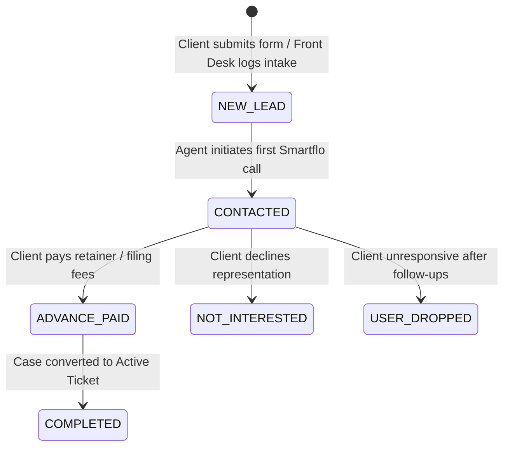
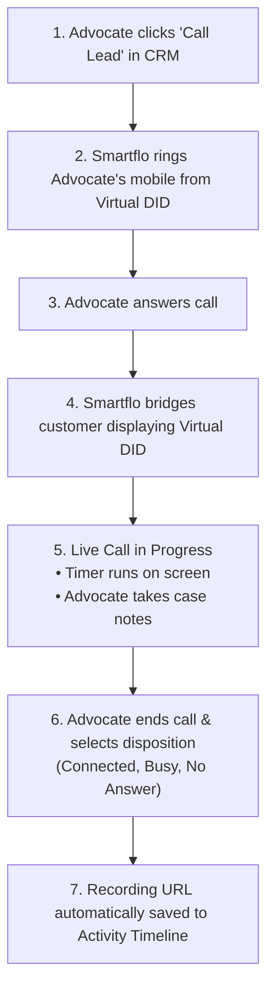

# User & Administrator Operational Manual

This manual provides comprehensive operational instructions for law firm partners, intake coordinators, and practicing advocates using the **Vakil Lead Flow CRM & Cloud Telephony Platform**.

---

## 1. System Access & Master Credentials

### 1.1 Live Portal URLs
* **Internal CRM Portal**: [https://vakil-lead-flow-main.vercel.app](https://vakil-lead-flow-main.vercel.app)
* **Login Page**: [https://vakil-lead-flow-main.vercel.app/login](https://vakil-lead-flow-main.vercel.app/login)
* **Public Client Lead Intake Portal**: [https://vakil-lead-flow-main.vercel.app/intake](https://vakil-lead-flow-main.vercel.app/intake)

### 1.2 Production Role Accounts & Master Credentials

All firm accounts use the master password `Password@123`:

| Role | User ID / Login Email | Password | Name | Assigned Calling Phone |
| :--- | :--- | :--- | :--- | :--- |
| **Super Admin** | `admin@vakiltech.com` | `Password@123` | Priya Sharma | `+91 9800000001` |
| **Front Desk** | `frontdesk@vakiltech.com` | `Password@123` | Rahul Verma | `+91 9800000002` |
| **Senior Lawyer** | `devika@vakiltech.com` | `Password@123` | Adv. Devika | `+91 9800000003` |
| **Corporate Lawyer** | `pritam@vakiltech.com` | `Password@123` | Adv. Pritam Banik | `+91 9800000004` |
| **Litigation Lawyer** | `aaditya@vakiltech.com` | `Password@123` | Adv. Aaditya | `+91 9800000005` |
| **General Lawyer** | `lawyer@vakiltech.com` | `Password@123` | Adv. Meera Patel | `+91 9800000006` |

> [!TIP]
> You can enter either your full email address (e.g. `admin@vakiltech.com`) or simply your short role identifier (e.g. `admin`, `frontdesk`, `devika`, `pritam`, `aaditya`, `lawyer`).

---

## 2. Authentication & Navigation

### 2.1 Logging In
1. Navigate to `https://vakil-lead-flow-main.vercel.app/login`.
2. Enter your assigned Email / User ID and Password.
3. Click **Authenticate**.
4. Upon successful login, you are redirected to the main dashboard tailored to your role.

### 2.2 Updating Your Calling Phone Number
Whenever an advocate initiates a call from the CRM, Tata Smartflo rings their mobile phone first. To verify or update which phone rings:
1. Tap the **More** icon in the bottom navigation bar (or desktop sidebar).
2. The top card displays your profile name, email, and **Calling Phone (Smartflo 2-Way Ring)**.
3. Click the **Change** button.
4. Enter your 10-digit Indian mobile number (e.g. `98XXXXXXXX`) and click OK.
5. The CRM immediately updates your active calling number across all two-way bridging operations.

---

## 3. Lead Management & Intake Workflows

### 3.1 Reviewing New Inquiries
* Incoming leads appear in the **New Leads** tab of [LeadsDashboard.tsx](file:///C:/Users/Ramanuj%20Dey%20Sarkar/Downloads/vakil-lead-flow-main/vakil-lead-flow-main/src/pages/LeadsDashboard.tsx).
* Each lead card presents:
  * Client Name and masked contact number (`+91 98••• ••210`).
  * Legal Service required (Legal Notice, Consultation, Document Drafting, Corporate Retainer).
  * Matter Budget and City location.
  * Follow-up attempt counters.

### 3.2 Triage & Case Assignment
1. Open the Lead Detail view by clicking on any lead card.
2. Under **Assigned Lawyer**, select the appropriate advocate based on case specialization:
   * **Adv. Devika**: High-value litigation and senior counsel matters.
   * **Adv. Pritam Banik**: Corporate retainer, M&A, and commercial contracts.
   * **Adv. Aaditya**: Criminal defense, civil litigation, and court appearances.
   * **Adv. Meera Patel**: Legal notices, consumer dispute drafts, and advisory.
3. Once assigned, the lead becomes visible in the lawyer's personal docket.

---

## 4. Legal Matter & Ticket Management

When a prospective client pays an advance or commits to representation, the lead is transitioned into an active **Legal Ticket**:

### 4.1 Service Packages & Billing Standards
The firm supports 4 standard matter categories with pre-configured fee structures:

| Service Category | Standard Retainer | Description |
| :--- | :--- | :--- |
| **Consultation** | ₹999 | 30-minute legal advisory with case analysis. |
| **Legal Notice** | ₹1,499 | Formal demand notice drafting, vetting, and dispatch via speed post. |
| **Document Drafting** | ₹2,499 | Custom contract, agreement, NDA, or power-of-attorney drafting. |
| **Corporate Retainer** | ₹9,999 / mo | Ongoing legal compliance, contract reviews, and business advisory. |

### 4.2 Updating Case Progress & Payments
1. Navigate to the **Tickets** view.
2. Select the matter by Reference ID (e.g. `VT-2026-98124`).
3. Under **Financials**, record any additional advance payments collected.
4. Update the Matter Status:
   * `WORK_UNDER_PROCESS`: Drafting or court filings in progress.
   * `CLIENT_NOT_RESPONDING`: Pending client documents or approvals.
   * `COMPLETED`: Notice served or contract executed.
   * `ARCHIVED`: Closed matter preserved for historical record.

---

## 5. Operating the Click-to-Call System

### 5.1 Dialing Instructions
1. Open any lead or ticket in the CRM.
2. Click the green **Call Lead** button.
3. The **Smartflo Call Modal** opens:
   * Displays the client's masked number.
   * Confirms your calling mobile number (`+91 98XXXXXXXX`).
4. Click **Start Two-Way Call**:
   * **Step 1**: Your personal phone will ring within 2–4 seconds from the company Virtual DID.
   * **Step 2**: Answer your phone.
   * **Step 3**: You will hear Smartflo ringing the client. The client sees the company Virtual DID on their caller ID.
5. While speaking, enter notes in the **Call Notes** textarea.
6. When the call ends, select the call disposition:
   * **Connected**: Meaningful consultation occurred.
   * **Busy / No Answer**: Reschedule a callback in follow-ups.
   * **Wrong Number / Switched Off**: Mark lead status accordingly.
7. Click **Log Activity & Close**.

### 5.2 Reviewing & Playing Call Recordings
* All completed calls appear in the client's **Activity Timeline**.
* Click the **Play** button on any call entry to stream the recording directly inside the browser.
* Use the scrubber bar to skip back or forward. Click the download icon to archive the audio file for case records.

---

## 6. Public Client Intake Portal (`/intake`)

The portal at `https://vakil-lead-flow-main.vercel.app/intake` is designed for public client self-service and walk-in intake:

1. **Client Information**:
   * Full Name.
   * 10-Digit WhatsApp Mobile Number (automatically prepended with `+91`).
   * Email Address and City / Location.
2. **Case Matter Details**:
   * Matter Title & Primary Service Needed.
   * Estimated Matter Budget & Priority (Urgent vs Standard).
   * Matter Description & Narrative.
3. **Instant Confirmation**:
   * Once submitted, a confirmation screen displays the unique **Matter Reference Code** (`VT-YYYY-XXXXX`).
   * The client can print or save their receipt.
   * The lead automatically appears in real-time on all active CRM dashboards.
