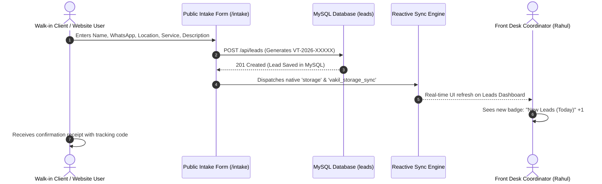
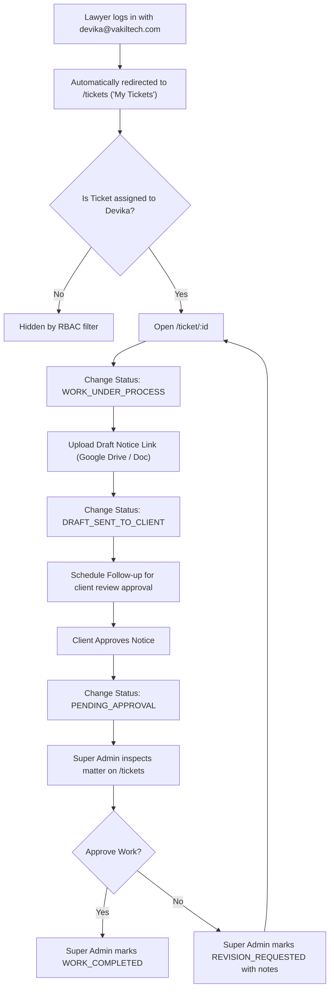
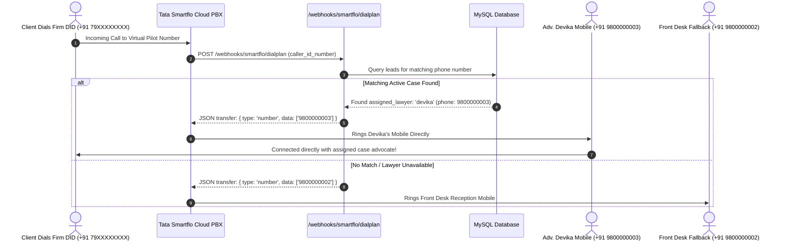
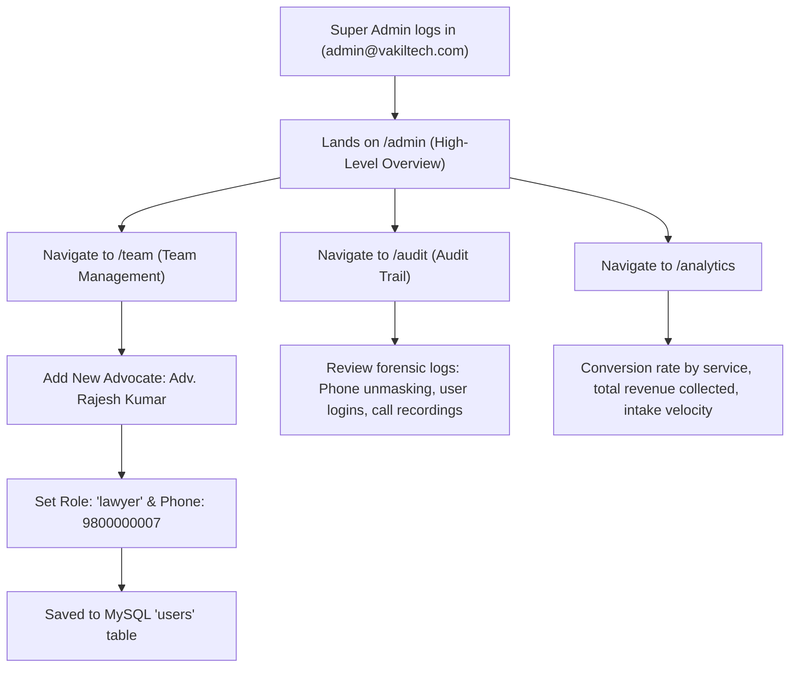

# User Roles, Permissions & Operational Userflows

This document details the functional capabilities of every user role in the **Vakil Lead Flow CRM & Cloud Telephony Platform**, accompanied by a granular permissions matrix and end-to-end userflows across real-world legal practice scenarios.

---

## 1. Role Capabilities & Permissions Matrix

The platform implements strict Role-Based Access Control (RBAC) across three internal firm tiers and one external public tier:
* **Super Admin**: Managing Partner / Firm Operations Lead
* **Front Desk**: Client Intake Specialists & Triage Coordinators
* **Lawyer (Case Handler)**: Advocates, Associates, and Practice Specialists
* **Client / Public**: Walk-in clients, website visitors, and active legal clients

| Functional Domain | Action / Feature | Super Admin | Front Desk | Lawyer (Case Handler) | Client / Public |
| :--- | :--- | :---: | :---: | :---: | :---: |
| **Authentication & Profile** | Login via Email / Role ID & Password | ✅ Full | ✅ Full | ✅ Full | ❌ N/A |
| | Update Calling Mobile Phone (Smartflo 2-Way Ring) | ✅ Yes | ✅ Yes | ✅ Yes | ❌ N/A |
| | Toggle Desktop Push Notifications (VAPID) | ✅ Yes | ✅ Yes | ✅ Yes | ❌ N/A |
| **Client Intake & Leads** | Submit Public Intake Form (`/intake`) | ✅ Yes | ✅ Yes | ✅ Yes | ✅ Yes (Self-service) |
| | View All Incoming & Unassigned Leads (`/leads`) | ✅ Full Access | ✅ Full Access | ❌ Restricted | ❌ N/A |
| | Filter Leads by Service, Status, and Search | ✅ Full | ✅ Full | ❌ Restricted | ❌ N/A |
| | View Raw (Unmasked) Client Mobile Numbers | ✅ Full (Eye Toggle) | ⚠️ Masked (`+91 98••• ••210`) | ⚠️ Masked (`+91 98••• ••210`) | ❌ N/A |
| | Edit Lead Location, Description, Service | ✅ Yes | ✅ Yes | ❌ Restricted | ❌ N/A |
| | Assign / Reassign Case Lawyer | ✅ Any Lawyer | ✅ Any Lawyer | ❌ Restricted | ❌ N/A |
| | Convert Lead to Active Legal Ticket | ✅ Yes | ✅ Yes | ❌ Restricted | ❌ N/A |
| | Archive / Delete Lead Record | ✅ Yes | ⚠️ Archive Only | ❌ Restricted | ❌ N/A |
| **Visual Pipeline** | Kanban Stage Drag & Drop (`/pipeline`) | ✅ Full Access | ✅ Full Access | ❌ Restricted | ❌ N/A |
| | Filter Pipeline by Lawyer & Service | ✅ Full | ✅ Full | ❌ Restricted | ❌ N/A |
| **Case Matters & Tickets** | View All Active Firm Tickets (`/tickets`) | ✅ Full Firm View | ✅ Full Firm View | ❌ Restricted | ❌ N/A |
| | View Assigned Cases ("My Tickets") | ✅ Full | ✅ Full | ✅ Filtered to Own Cases | ❌ N/A |
| | Update Case Stage Progression | ✅ Yes | ✅ Yes | ✅ Yes (Own cases) | ❌ N/A |
| | Upload / Edit Legal Draft Links & Documents | ✅ Yes | ✅ Yes | ✅ Yes (Own cases) | ❌ N/A |
| | Approve Completed Work (`PENDING_APPROVAL`) | ✅ Approve / Reject | ❌ Restricted | ⚠️ Submit for Approval | ❌ N/A |
| **Follow-ups & Reminders** | Schedule Follow-up Call / WhatsApp (`/followups`) | ✅ Yes | ✅ Yes | ✅ Yes (Own cases) | ❌ N/A |
| | Complete & Reschedule Pending Follow-ups | ✅ Yes | ✅ Yes | ✅ Yes (Own cases) | ❌ N/A |
| | Overdue & Due Today Smart Triage Badge | ✅ Yes | ✅ Yes | ✅ Yes | ❌ N/A |
| **Cloud Telephony (Tata Smartflo)** | Place Outbound Click-to-Call (Two-Way Bridging) | ✅ Yes | ✅ Yes | ✅ Yes (Assigned cases) | ❌ N/A |
| | Automatic Call Recording Playback & Scrubbing | ✅ Yes | ✅ Yes | ✅ Yes (Assigned cases) | ❌ N/A |
| | Inbound Sticky Call Forwarding (Direct to Mobile) | ✅ Fallback Receiver | ✅ General Queue | ✅ Sticky Case Routing | 📞 Inbound Caller |
| | In-Call Consultation Notes & Disposition Tagging | ✅ Yes | ✅ Yes | ✅ Yes | ❌ N/A |
| | Test & Inspect API Dialplan Webhook (`/more`) | ✅ Yes | ⚠️ View Only | ❌ Restricted | ❌ N/A |
| **Billing & Financials** | Set Case Total Fee & Advance Payment | ✅ Yes | ✅ Yes | ⚠️ View Only | ❌ N/A |
| | Record Client Balance Due Payments | ✅ Yes | ✅ Yes | ⚠️ View Balance | ❌ N/A |
| | Firm Financial Analytics & Revenue Velocity | ✅ Full Access | ❌ Restricted | ❌ Restricted | ❌ N/A |
| **Governance & Security** | View System Audit Trail (`/audit`) | ✅ Full Access | ❌ Restricted | ❌ Restricted | ❌ N/A |
| | Team Management (`/team` - Add/Edit Staff) | ✅ Full Access | ❌ Restricted | ❌ Restricted | ❌ N/A |
| | Export / Import JSON & MySQL Database Backups | ✅ Full Access | ❌ Restricted | ❌ Restricted | ❌ N/A |

---

## 2. Operational Userflows & Scenarios

### Scenario 1: Public Intake, Triage & Real-Time Sync



#### Step-by-Step Flow:
1. **Intake Submission**: The client or front-desk receptionist opens `/intake`. They select the legal service required (*Legal Notice, Consultation, Document Drafting, or Corporate Retainer*), enter their WhatsApp phone number, and input case details.
2. **Reference Code Issuance**: The system generates a formatted tracking reference (e.g. `VT-2026-8492`).
3. **Database Insertion**: The lead is recorded into the MySQL `leads` table and locally cached in `localStorage`.
4. **Cross-Tab Reactivity**: An event broadcast immediately notifies open internal dashboard tabs. The front-desk triage screen updates within milliseconds without requiring page reloads.

---

### Scenario 2: Lead Triage, Two-Way Masked Calling & Lawyer Assignment

```mermaid
sequenceDiagram
    autonumber
    actor FrontDesk as Front Desk (Rahul)
    participant CRM as Vakil CRM (/lead/:id)
    participant Smartflo as Tata Smartflo PBX
    actor Lawyer as Adv. Devika (Case Lawyer)
    actor Client as Customer (+91 98••• ••210)

    FrontDesk->>CRM: Opens Lead Detail & clicks "Call Lead"
    CRM->>Smartflo: POST /v1/click_to_call (agent: FrontDesk, destination: Customer, caller_id: Firm DID)
    Smartflo->>FrontDesk: Leg 1: Rings FrontDesk Mobile
    FrontDesk->>Smartflo: Answers call
    Smartflo->>Client: Leg 2: Rings Client displaying Firm DID
    Client->>Smartflo: Client answers; conversation bridged & recorded
    FrontDesk->>CRM: Takes consultation notes & tags disposition: 'Connected'
    Smartflo->>CRM: Webhook: Audio recording synced & attached to timeline
    FrontDesk->>CRM: Marks status 'ADVANCE_PAID', assigns Adv. Devika, sets fee
    CRM->>CRM: Auto-converts Lead into active Ticket
    CRM-->>Lawyer: In-app & Web Push Notification: "New matter assigned"
```

#### Step-by-Step Flow:
1. **Review & Initial Contact**: Front Desk inspects the lead on [LeadDetail.tsx](file:///C:/Users/Ramanuj%20Dey%20Sarkar/Downloads/vakil-lead-flow-main/vakil-lead-flow-main/src/pages/LeadDetail.tsx). The customer phone number is privacy-masked (`+91 98••• ••210`).
2. **Two-Way Click-to-Call**: Front Desk clicks **Call Lead**. Tata Smartflo dials the receptionist's registered mobile first. Upon answering, Smartflo rings the client showing the firm's virtual DID.
3. **Recording Sync**: Upon hanging up, Smartflo invokes `/webhooks/smartflo/hangup`. The audio recording is stored in MySQL and immediately playable on the activity timeline with playback scrubbing.
4. **Lawyer Assignment**: Front Desk records advance payment received (e.g. ₹2,500), assigns **Adv. Devika**, and saves.
5. **Conversion to Matter**: The CRM converts the lead into an active matter ticket under Devika's queue and fires a Web Push notification to Devika's device.

---

### Scenario 3: Lawyer Case Execution, Drafting & Super Admin Approval



#### Step-by-Step Flow:
1. **Isolated Lawyer View**: Adv. Devika logs in. Her bottom navigation shows strictly **My Tickets**, **Follow-ups**, and **More**. She cannot see unassigned leads, firm financial analytics, or other lawyers' files.
2. **Matter Work**: Devika opens the ticket, reviews the client's problem, and moves stage to `WORK_UNDER_PROCESS`.
3. **Draft Submission**: Devika drafts the legal notice and pastes the secure review document URL into the Case Documents tab.
4. **Follow-Up Scheduling**: Devika schedules a follow-up for 48 hours to confirm client approval before dispatch.
5. **Quality Review**: Devika moves the ticket to `PENDING_APPROVAL`. Super Admin Priya reviews the drafted notice, confirms statutory compliance, and marks the matter `WORK_COMPLETED`.

---

### Scenario 4: Inbound Callback on Firm DID (Sticky Dynamic Routing)



#### Step-by-Step Flow:
1. **Customer Inbound Call**: A client who previously submitted an inquiry calls back on the firm's virtual DID.
2. **Dynamic Dialplan Webhook**: Smartflo calls `/webhooks/smartflo/dialplan` with the caller's CLI.
3. **Sticky Lawyer Resolution**: The backend queries MySQL to see if the caller has an assigned case advocate. If Adv. Devika is handling their case, the webhook immediately instructs Smartflo to route the call to Devika's mobile phone.
4. **Zero IVR Friction**: The customer avoids listening to long IVR menus and connects directly with their advocate.
5. **Missed Call Fallback**: If Devika is in court or on another call, Smartflo triggers `/webhooks/smartflo/missed`, logging a missed callback banner in the CRM and firing an urgent push notification.

---

### Scenario 5: Retainer Billing, Balance Due & Case Archival

```mermaid
flowchart LR
    Matters["Active Matter (/ticket/:id)"] --> TotalFee["Total Matter Fee: ₹15,000"]
    TotalFee --> Advance["Advance Received: ₹5,000<br/>Balance Due: ₹10,000"]
    Advance --> ClientPays["Client Pays Balance (₹10,000)"]
    ClientPays --> RecordPayment["Front Desk / Admin records payment in CRM"]
    RecordPayment --> BalanceZero["Balance Due: ₹0.00 (Fully Settled)"]
    BalanceZero --> WorkDone["Work Completed & Notice Served"]
    WorkDone --> ArchiveMatter["Admin clicks 'Archive Ticket'"]
    ArchiveMatter --> Preserved["Preserved in Archived Matters for Compliance Audit"]
```



#### Step-by-Step Flow:
1. **Billing Tracking**: On the ticket detail page, total service fees and collected advances are clearly displayed alongside the remaining balance.
2. **Balance Collection**: When the drafting is ready for execution, the client settles the remaining ₹10,000.
3. **Record Settlement**: Front Desk or Admin enters the payment in the ticket's financial section. The balance due recalculates to ₹0.00.
4. **Matter Archival**: Once the legal notice is confirmed delivered, the matter is archived. The case remains queryable in the searchable archive for statutory compliance and bar council audit purposes.

---

### Scenario 6: Super Admin Governance, Team Allocation & Audit



#### Step-by-Step Flow:
1. **Administrative Governance**: Super Admin Priya Sharma logs in and views firm-wide operational KPIs.
2. **Team Expansion**: Priya navigates to [TeamManagement.tsx](file:///C:/Users/Ramanuj%20Dey%20Sarkar/Downloads/vakil-lead-flow-main/vakil-lead-flow-main/src/pages/TeamManagement.tsx) to onboard new advocates, update their calling numbers, or adjust permissions.
3. **Forensic Audit**: Priya inspects [AuditTrail.tsx](file:///C:/Users/Ramanuj%20Dey%20Sarkar/Downloads/vakil-lead-flow-main/vakil-lead-flow-main/src/pages/AuditTrail.tsx) to audit compliance (e.g. verifying which staff member unmasked a client's private phone number or deleted a lead).
4. **Performance Optimization**: Priya analyzes intake conversion bottlenecks on [Analytics.tsx](file:///C:/Users/Ramanuj%20Dey%20Sarkar/Downloads/vakil-lead-flow-main/vakil-lead-flow-main/src/pages/Analytics.tsx).
